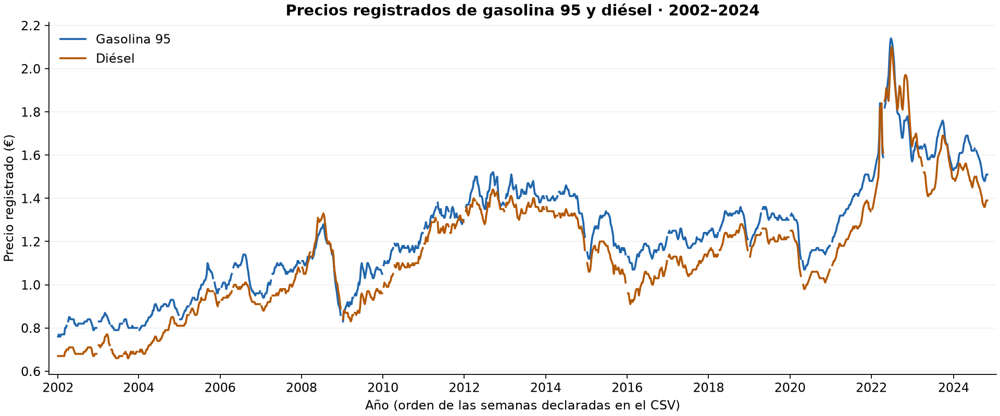

# Análisis exploratorio de precios de combustibles

Proyecto académico de **Álvaro Quero Sandoval**, titulado en DAM y en la especialización
de Inteligencia Artificial y Big Data, y estudiante de DAW.

Análisis descriptivo de 1.134 registros de gasolina 95 y diésel entre 2002 y 2024.
El trabajo se centra en validar los datos, visualizar su evolución y comparar ambos combustibles.

**[Ver el informe](informe.html)** · **[Revisar el notebook](EDA_Combustibles.ipynb)** ·
**[Consultar el detalle interactivo](resultados/detalle_interactivo.html)**

Los HTML pueden descargarse y abrirse en el navegador. Para ofrecerlos directamente en una web,
se pueden alojar como archivos estáticos junto con la carpeta `resultados/`.

> **Procedencia pendiente de verificar.** El archivo se describió originalmente como precios
> en España, pero no se ha recuperado su fuente. No se confirman su representatividad, la
> unidad exacta, el calendario ni las condiciones de reutilización. Véase [DATOS.md](DATOS.md).



## Qué se analiza

- Calidad de los datos: tipos, valores inválidos, ausencias y duplicados por año y semana.
- Cobertura anual, con las semanas sin registro visibles y 2024 identificado como parcial.
- Evolución de los precios, máximos y mínimos observados, y resúmenes anuales.
- Diferencia entre combustibles usando únicamente pares completos.
- Distribución histórica con intervalos comunes y un selector interactivo por año.

## Resultados del archivo

- **1.134 registros** y **1.133 pares completos**.
- Un precio de diésel ausente en 2020, semana 17. Se conserva sin imputar.
- Máximo observado de gasolina: **2,14 €**, en 2022, semana 26.
- Máximo observado de diésel: **2,10 €**, en 2022, semana 27.
- El diésel supera a la gasolina en **75 pares**
  (**6,6 %** de los pares disponibles).

Las cantidades en euros siguen la descripción original. No son estadísticas nacionales
verificadas ni precios actuales. Los resultados describen exclusivamente el CSV entregado.

## Decisiones del análisis

Se mantiene el valor ausente en lugar de sustituirlo por la mediana de más de veinte años.
Las curvas no unen huecos y el eje usa las semanas declaradas sin inventar fechas ISO.
No se infiere estacionalidad a partir de promedios de semanas con distinta composición anual.
No se atribuyen cambios de precio a acontecimientos históricos sin evidencia adicional.

## Ejecución reproducible

Entorno comprobado: **Python 3.14.7**. Las versiones directas están
fijadas en `requirements.txt`. `requirements-lock.txt` registra también las dependencias
transitivas del entorno Windows usado en la revisión.

Desde esta carpeta, en Windows:

```powershell
python -m venv .venv
.venv\Scripts\python.exe -m pip install -r requirements.txt
.venv\Scripts\python.exe ejecutar.py
```

En macOS o Linux, usar `.venv/bin/python` en los dos últimos comandos. Esos sistemas no se
han probado en esta revisión. Para reproducir las dependencias exactas del entorno Windows,
instalar `requirements-lock.txt` en lugar de `requirements.txt`.

`ejecutar.py` arranca un kernel limpio con el mismo Python, ejecuta todas las celdas y guarda
el notebook con sus salidas, el informe HTML, las imágenes, las tablas y el resumen de resultados.
No necesita una instalación global de Jupyter ni modifica el CSV. La ejecución falla si una
celda encuentra un error. Para editar de forma interactiva puede abrirse el notebook en un
editor compatible con Jupyter y seleccionar el entorno instalado.

## Archivos

| Archivo | Contenido |
| --- | --- |
| `EDA_Combustibles.ipynb` | Código, explicación y resultados ejecutados |
| `gasolina.csv` | Datos originales, con el nombre actualizado |
| `DATOS.md` | Diccionario, trazabilidad y límites de la procedencia |
| `ejecutar.py` | Ejecución completa y exportación del informe |
| `informe.html` | Lectura del análisis sin mostrar el código |
| `resultados/` | Figuras, tablas, resumen JSON y detalle interactivo |

## Limitaciones

La procedencia y los metadatos no se han podido verificar. La cobertura cambia entre años,
hay una semana 53 en 2022 sin convención documentada y 2024 solo llega a la semana 44.
Los precios no están ajustados por inflación. El análisis no demuestra causalidad ni estacionalidad.
La prioridad de una futura ampliación es recuperar una fuente trazable y contrastar los registros.

## Qué demuestra este proyecto

Preparación de datos con pandas, validaciones explícitas, agregaciones, visualización con
Matplotlib y Plotly, documentación de limitaciones y ejecución reproducible con Jupyter.
Es un EDA académico revisado, sin modelo predictivo ni infraestructura de Big Data.
