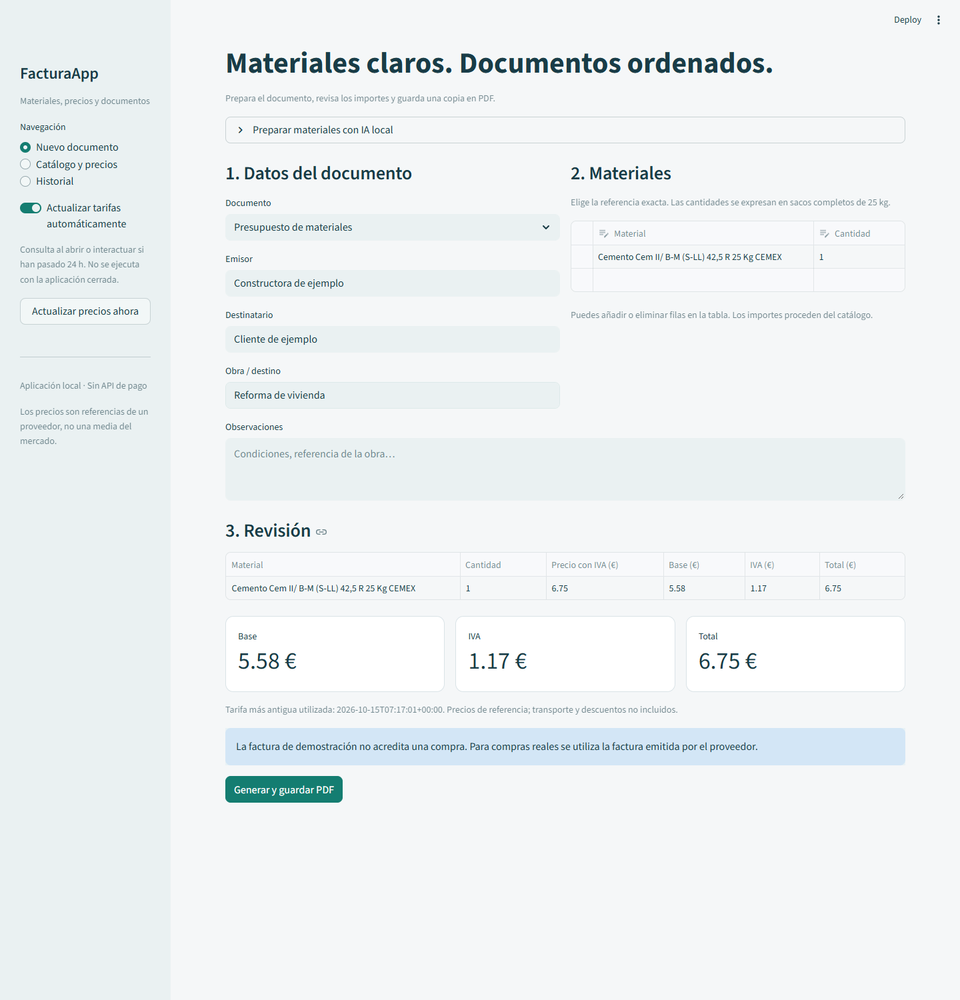

# FacturaApp

Aplicación local para preparar presupuestos de materiales de construcción y facturas de demostración, consultar precios publicados por un proveedor y guardar documentos PDF con historial.

**Python · Streamlit · SQLite · Decimal · ReportLab · Ollama opcional**

## Empezar

Requiere Python 3.12. Desde esta carpeta, en PowerShell:

    py -3.12 -m venv .venv
    .\.venv\Scripts\python.exe -m pip install -r requirements.txt
    .\.venv\Scripts\python.exe -m streamlit run app.py

Abre http://localhost:8501. El modo manual no necesita Ollama ni una clave de API.

1. Completa emisor, destinatario y obra.
2. Selecciona los materiales y el número de sacos en la tabla.
3. Revisa base, IVA e importe total.
4. Genera el PDF. Se guarda en el historial y puedes descargarlo de nuevo.

## Precios conectados

La aplicación consulta las fichas públicas de **Pochiche** para tres referencias:

- [Cemento blanco LAFARGE, saco de 25 kg](https://pochiche.com/materiales-construccion/cemento-blanco-iial-425-r).
- [Cemento gris CEMEX, saco de 25 kg](https://pochiche.com/materiales-construccion/cem-ii-bm-sll-425-r).
- [Mortero MM30 FASSA, saco de 25 kg](https://pochiche.com/materiales-construccion/mortero-cementoso-mamposteria-mm30).

Extrae una oferta estructurada de la propia ficha, comprueba producto, presentación, moneda, disponibilidad y fecha de validez. Los precios se muestran con IVA incluido. Para el desglose de la demostración se configura un tipo del 21 %; no se infiere automáticamente del tratamiento fiscal de una operación real.

No es una API oficial concertada ni una media del mercado. Son precios publicados por un proveedor concreto, sujetos a sus condiciones, stock y posibles cambios. Transporte y descuentos no están incluidos. No existe afiliación con el proveedor.

La actualización automática se intenta al abrir o interactuar con la aplicación cuando han pasado 24 horas desde el último intento. No es un servicio en segundo plano y no se ejecuta con la aplicación cerrada. También hay un botón para actualizar.

Si una consulta falla, conserva el precio y la fecha anteriores y muestra un aviso. Nunca cambia la fecha de consulta de un precio que no se ha actualizado. El catálogo inicial contiene una captura real consultada el 15/10/2026, identificada con sus fechas; no se presenta como una consulta en tiempo real.

También puedes ejecutar:

    .\.venv\Scripts\python.exe actualizar_precios.py

Ese comando permite una futura programación externa. No crea tareas programadas por sí mismo.

## IA local opcional

Instala [Ollama](https://ollama.com/) y descarga un modelo compatible:

    ollama pull qwen2.5:3b

Mantén Ollama iniciado. En «Preparar materiales con IA local», escribe, por ejemplo:

> Necesito 20 sacos de cemento gris y 10 sacos de mortero.

La aplicación envía únicamente la petición y las referencias del catálogo al servicio local en 127.0.0.1:11434. Solicita una respuesta JSON, valida los IDs y las unidades y permite revisar la propuesta antes de usarla. El modelo puede equivocarse: el usuario revisa cantidades y materiales no identificados. La IA no establece precios ni realiza los cálculos.

Puedes cambiar el modelo en la interfaz o con OLLAMA_MODEL. Los modelos se descargan por separado y tienen sus propias licencias. Consulta [la ficha de qwen2.5:3b](https://ollama.com/library/qwen2.5:3b).

**Estado de validación:** contrato HTTP y validaciones de la integración probados con respuestas simuladas. No se ha ejecutado una inferencia real porque Ollama no estaba instalado en el equipo de pruebas. El modo manual, la fuente de precios real y el PDF sí se han probado.

## Documentos y persistencia

- Importes calculados con Decimal y redondeo explícito a céntimos.
- Se calcula el total de cada línea desde el precio bruto publicado; se desglosan base e IVA sin volver a sumar IVA al precio de catálogo.
- SQLite almacena documento, líneas, fuente, fechas y PDF en una transacción.
- Un fallo al crear el PDF no añade una entrada incompleta al historial.
- Repetir la misma operación de generación no crea duplicados.
- Las actualizaciones de precios no modifican documentos ya guardados.
- Los datos locales se guardan en data/factura.sqlite3. Haz copia de ese archivo para conservar el historial.

Esta versión de portfolio genera presupuestos y **facturas de demostración**. No es un sistema de facturación fiscal ni acredita compras; para registrar una compra real debe utilizarse la factura del proveedor. No emite documentos en nombre de Pochiche.

## Pruebas

    .\.venv\Scripts\python.exe -m pip install -r requirements-dev.txt
    .\.venv\Scripts\python.exe -m pytest tests -q

37 pruebas superadas. Consulta [PRUEBAS.md](docs/PRUEBAS.md). Incluyen cálculo, validación, fallos de conexión, persistencia, concurrencia, PDF de varias páginas e interacción con Streamlit.

## Estructura

    app.py                  Interfaz
    core.py                 Validaciones y cálculos
    supplier.py             Conector de precios de Pochiche
    ai.py                   Integración opcional con Ollama
    storage.py              Historial y transacciones SQLite
    pdf_export.py           Documentos PDF
    actualizar_precios.py   Actualización ejecutable por separado
    examples/               Captura de precios y PDF de ejemplo
    tests/                  Pruebas automáticas
    docs/                   Capturas y validación

La aplicación está configurada para uso local. No incluye usuarios, autenticación ni aislamiento de datos entre clientes para un despliegue público.

Autor: Álvaro Quero Sandoval.
