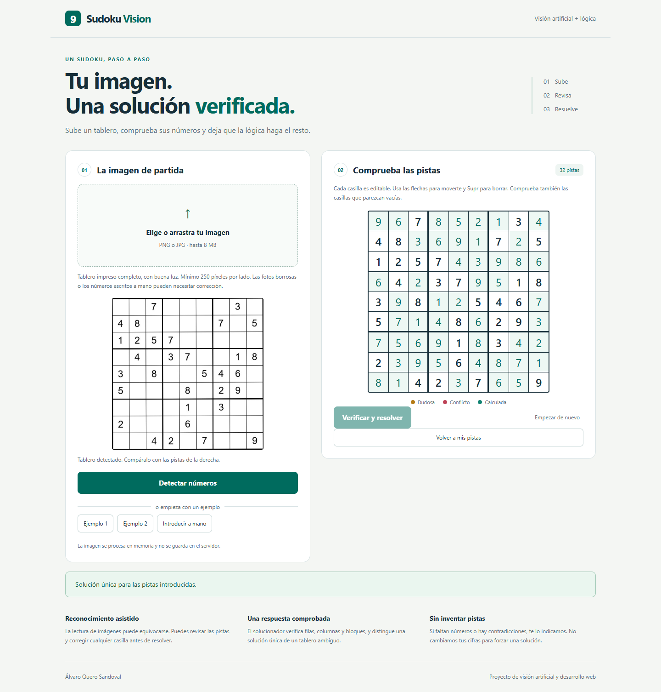

# SudokuVision

Aplicación web para subir la imagen de un Sudoku, revisar las cifras detectadas y obtener una solución cuya unicidad se comprueba.

**Python · Flask · OpenCV · TensorFlow/Keras · JavaScript**

## Qué puedes probar

1. Sube una imagen PNG o JPG, o pulsa uno de los dos ejemplos.
2. Detecta el tablero y compara **todas** las pistas con la imagen. Puedes editar las casillas, incluidas las vacías.
3. Pulsa **Verificar y resolver**.
4. Las cifras calculadas aparecen en verde. Puedes volver a tus pistas originales.

También se puede introducir el tablero manualmente. Si las pistas se contradicen, no tienen solución o admiten varias, la aplicación lo explica sin presentar una solución como definitiva.

## Ejecutar en tu equipo

Entorno comprobado: Windows, Python **3.12.15**, CPU. No hace falta GPU. La instalación inicial descarga TensorFlow y puede tardar.

Desde esta carpeta, en PowerShell:

    py -3.12 -m venv .venv
    .\.venv\Scripts\python.exe -m pip install -r requirements.txt
    .\.venv\Scripts\python.exe app.py

Abre http://127.0.0.1:8000 y mantén la terminal abierta. Ctrl+C detiene el servidor.

En Linux con Python 3.12:

    python3.12 -m venv .venv
    .venv/bin/python -m pip install -r requirements.txt
    .venv/bin/python app.py

La primera lectura tarda más porque carga el modelo; las siguientes reutilizan el mismo modelo.
Las dependencias directas están fijadas en requirements.txt. requirements-lock.txt registra el entorno completo de pruebas en Windows, incluyendo herramientas de desarrollo; no se presenta como un bloqueo multiplataforma.

## Cómo funciona

- **Imagen:** detección de una cuadrícula 9 × 9, corrección de perspectiva y comparación de cuatro orientaciones.
- **Cifras:** normalización de iluminación, extracción de componentes y clasificación con el modelo incluido.
- **Revisión:** cuadrícula editable, marcas de incertidumbre y de números repetidos. La confianza del modelo no equivale a certeza.
- **Resolución:** validación estricta y búsqueda con selección de la casilla con menos candidatos. Busca hasta dos soluciones para distinguir unicidad y ambigüedad.
- **Límites:** hasta 8 MB por petición y 12 megapíxeles, concurrencia acotada y límite de cálculo del solucionador. Imágenes procesadas en memoria por la configuración incluida.

El solucionador no se utiliza para cambiar automáticamente las predicciones y hacerlas encajar.

## Pruebas y resultados

Se han comprobado **10 tableros distintos y 70 imágenes generadas**:

| Conjunto | Lectura íntegramente correcta | Rechazo explícito |
|---|---:|---:|
| 5 tableros × 10 variantes de desarrollo | 40/50 | 10/50 |
| 5 tableros adicionales × 4 variantes | 20/20 | 0/20 |

Las diez imágenes rechazadas son las versiones de 144 × 144 píxeles y de desenfoque intenso. Las 60 aceptadas conservaron exactamente las pistas y produjeron la solución esperada, sin correcciones manuales. **Estos resultados no representan una tasa de acierto garantizada para fotografías reales.**

Además: **26 pruebas automáticas** de lógica/API y **5 recorridos completos en Chrome** con subidas diferentes, edición de pistas y resolución, más comprobación de interfaz a 390 píxeles de ancho.

Consulta [el informe de pruebas](docs/PRUEBAS.md), sus resultados JSON y las imágenes originales de prueba.

Para repetir:

    .\.venv\Scripts\python.exe -m pip install -r requirements-dev.txt
    .\.venv\Scripts\python.exe -m pytest tests/test_app.py -q
    .\.venv\Scripts\python.exe tests/benchmark.py
    .\.venv\Scripts\python.exe tests/benchmark.py holdout.json holdout-results.json

Para el navegador, con el servidor iniciado en otra terminal:

    .\.venv\Scripts\python.exe -m playwright install chromium
    .\.venv\Scripts\python.exe tests/browser_check.py

Se puede usar un Chrome instalado indicando su ruta en la variable CHROME_PATH. No ejecutes varias pruebas de navegador consecutivas en menos de un minuto: la aplicación limita las peticiones.

## Alcance y limitaciones

Pensado para **Sudokus clásicos impresos de 9 × 9**, con una sola cifra por casilla, tablero completo y fondo claro. Fotos con reflejos, curvatura, recortes, anotaciones o escritura manual pueden necesitar corrección o ser rechazadas.

El modelo procede del proyecto original. No se incluye un proceso de entrenamiento reproducible ni se atribuye una precisión de entrenamiento no documentada. Consulta [la ficha del modelo](models/MODELO.md).

## Estructura

    app.py                 Rutas, límites y servidor
    vision.py              Lectura de imágenes
    solver.py              Validación y resolución
    templates/             Página principal
    static/                Diseño, interacción y ejemplos
    models/                Modelo y ficha
    tests/                 Pruebas y 70 imágenes con resultados esperados
    docs/                  Resultados, capturas y publicación

## Publicación y portfolio

La aplicación está validada localmente. Para que otra persona suba su Sudoku desde Notion necesita una **URL pública de este servidor**, no un HTML estático.

Consulta [DESPLIEGUE.md](docs/DESPLIEGUE.md) y [PORTFOLIO.md](docs/PORTFOLIO.md).

Autor: Álvaro Quero Sandoval.
